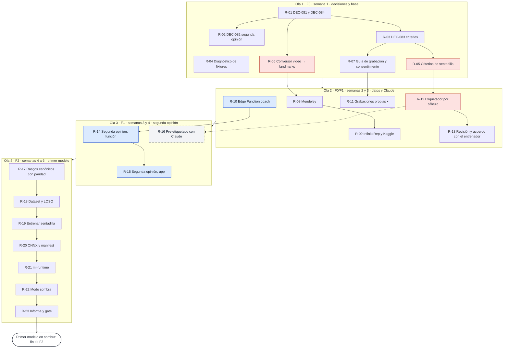

# Hoja de ruta del giro comercial: una tarea por sesión

_Creada el 30 de octubre de 2026. Ordena en tareas de una sesión todo lo que
`docs/PLAN-COMERCIAL.md` define (fases F0 a F4). El QUÉ de cada entrega sigue
en el plan; este archivo fija el ORDEN, el MODELO y el ESTADO. Convive con
`docs/STATUS.md` (el sprint del seminario, que lo actualiza el líder) y no lo
sustituye: lo que queda del Sprint 2 se cierra por su propia cola._

## 1. Cómo se usa

Este archivo es lo que mantiene sincronizadas las sesiones. Ninguna sesión
recuerda lo que hizo la anterior: lo sabe porque está escrito aquí.

**Al abrir una sesión**

0. Mira 3.2, «Olas: la cola, en orden»: toca la primera fila ⬜ cuyas
   dependencias estén ✅ y que no esté ⏸. 3.1 dibuja el camino y 3.3 lista
   todas las filas.
1. Elige el modelo con `/model` según la columna «Modelo» de la tarea
   (vocabulario de `DEC-062`: Sonnet medio por defecto; Opus plan para
   contratos, umbrales con golden o varios módulos; Opus alto para geometría
   y máquinas de estados; bajo para docs y commits).
2. Pega:

   > Tarea **R-xx** de `docs/ROADMAP-COMERCIAL.md`. Lee esa fila, la sección
   > de `docs/PLAN-COMERCIAL.md` que cita y el código que toca; nada más del
   > contexto salvo la DEC puntual que necesites. Una rama desde `main`,
   > `pnpm check` en verde, `/pr-ready` y PR. En el mismo PR marca la fila
   > como hecha en 3.2 y 3.3 y anota en la sección 4 lo que hayas decidido.

**Durante la sesión**

- Si aparece una decisión que no está escrita (un umbral, una dependencia,
  un formato de datos), la sesión SE DETIENE y pregunta. Si se deriva de lo
  escrito en el plan o en una DEC, la resuelve y la anota en la sección 4
  como «coordinador bajo la delegación».
- Las dependencias nuevas de `package.json` se discuten antes (regla dura
  9). Las de Python en `ml/` las cubre `DEC-084` una vez aceptada (R-01).
- Si la tarea resulta más grande que una sesión, se parte: lo hecho entra
  como R-xx a, lo que falta queda como R-xx b en esta tabla. Una tarea es
  una rama y un PR, aunque pase de 400 líneas; no se subdivide en más ramas.
- Lo que toca `src/contracts/**`, `packages/contracts/**` o
  `models/manifest.json` va en rama `adr/*` o `contracts/*` (el hook
  `guard-protected-paths.mjs` lo bloquea en cualquier otra).
- Cámara, trackers, voz, PWA o modelo en el celular: la tarea dice en su PR
  qué probó en un celular real y qué no.

**Al cerrar una sesión**

- El PR de la tarea cambia su estado a ✅ con el número del PR en 3.2, y en
  3.3 tacha su fila y dice lo que dejó pendiente. Va en el mismo PR, nunca
  en uno aparte. `docs/STATUS.md` no se toca (DEC-062).
- Lo que la tarea decidió va a la sección 4. Si es una decisión técnica con
  alternativas, además se escribe con `/adr`.
- Si es visible al usuario, entrada en `docs/CHANGELOG.md`.
- Commit con conventional commit en español; el PR lo fusiona govandoh con
  CI en verde (DEC-070). `/clear` antes de la siguiente tarea.

**Estados:** ✅ hecho · ⬜ pendiente · ⏸ espera algo de Gerardo · ➖
retirado · ◌ opcional, entra si alcanza el tiempo.

## 2. Lo que ya está hecho

Lo que el giro comercial hereda del seminario y de la sesión del 30 de
octubre. No se repite.

| Qué | Dónde |
|---|---|
| El plan comercial completo: decisión, mercado, criterios de etiquetado, datos usables y prohibidos, Claude como IA provisional, roadmap F0 a F4, DECs por escribir y pendientes no técnicos | `docs/PLAN-COMERCIAL.md` |
| MediaPipe Pose (33 landmarks, `pose_landmarker_lite`) y el motor 3D puro: filtro One Euro, nivelación por gravedad, calibración de pie, vector de rasgos del k-NN, con tests | `src/pose/`, `src/geometry/` (DEC-054) |
| El contador 3D configurable de los siete ejercicios y sus umbrales (la ola 1 sin calibrar con personas) | `src/exercises/tracker3d.ts`, `definitions3d.ts` (DEC-057, DEC-066, DEC-078) |
| La política de voz y el resumen de serie | `src/feedback/feedbackPolicy.ts`, `src/analysis/setSummary.ts` (DEC-016) |
| El k-NN con LOSO, escrito pero sin conectar a la app | `src/analysis/poseClassifier.ts`, `knnDataset.ts`, `scripts/knn-model.ts` (DEC-055; #36 y #14 abiertas) |
| 25 fixtures de landmarks, 10 con `expected`; grabación con `?debug=record` y reproducción | `fixtures/landmarks/`, `src/testing/fixtureRecorder.ts`, `src/testing/replay.ts` |
| El esquema v2 de datasets y su validador en Python; fichas de MM-Fit y Fitness-AQA (solo lectura, no se entrena con ellos) | `ml/datasets/validate_v2.py`, `ml/datasets/*/dataset.json` (DEC-065) |
| La arquitectura híbrida: MediaPipe como ojo, modelo pequeño en el dispositivo por ONNX, reglas como respaldo, LLM solo con métricas, cuadro clave por rep como segunda opinión | `docs/adr/DEC-027`, `ARCHITECTURE.md` |
| El coach por Claude decidido, con la tabla `coach_usage` y el tope de costo; la Edge Function todavía no existe | `DEC-033`, `DEC-067`, `supabase/migrations/20261018000000_antitrampa_y_coach_usage.sql` |
| Supabase con 13 migraciones, RLS con pgTAP, auth (DEC-069), sincronización con cola offline (DEC-079) y Web Push (DEC-080) | `supabase/`, `src/api-client/` |
| Pagos simulados con `MockPaymentProvider` (regla dura 8, transitoria desde DEC-081) | `src/domain/payment.ts` |
| Consentimiento y hoja de registro de grabaciones, hoy con cláusula no comercial | `docs/CONSENTIMIENTO-GRABACION.md`, `docs/REGISTRO-GRABACIONES.md` (DEC-064) |
| La investigación del 30 de octubre: licencias de datasets, vendedores, SDKs, biomecánica, benchmark FitAQA, costo de Claude | `docs/PLAN-COMERCIAL.md` §2, §3, §5 y «Fuentes» |

## 3. Las tareas, en orden

Cada fila es UNA sesión, UNA rama y UN PR. «Depende de» significa que esa
tarea tiene que estar fusionada antes. La tarea que toca es la primera fila
⬜ de 3.2 cuyas dependencias estén ✅. Las semanas cuentan desde la primera
sesión de construcción, no desde hoy.

### 3.1 El camino hasta el primer modelo en sombra

En rojo, lo que el primer modelo no puede perder: sin criterios (R-05),
conversor (R-06) y etiquetador (R-12) no hay dataset. En azul, lo que la
versión inicial vendible necesita aunque el modelo tarde. En gris punteado,
lo opcional.

### 3.2 Olas: la cola, en orden

Una sesión a la vez. Mientras el PR de una tarea espera, la sesión siguiente
toma la próxima fila que no dependa de ese PR.

#### Ola 1 · F0 · semana 1 · las decisiones y la base

| Orden | ID | Tarea | Plan | Modelo | Depende de | Hecho cuando | Estado |
|---|---|---|---|---|---|---|---|
| 1 | R-01 | **DEC-081, el giro comercial, y DEC-084, el entorno Python de `ml/`.** Con `/adr`: DEC-081 declara el producto comercial con facturación futura, datos solo con derechos comerciales y Claude en producción; marca DEC-035 y DEC-065 como sustituidas y vuelve transitorias las reglas duras 7 y 8 en `AGENTS.md` (se reescriben las dos filas, no se borran). DEC-084 autoriza `ml/requirements.txt` con MediaPipe, PyTorch y ONNX como entorno de C, fuera del bundle. Filas en `docs/adr/README.md` y `DECISIONS.md`. Rama `adr/giro-comercial` | §1, §8 | Sonnet medio | — | Las dos DEC «Aceptada» con fecha; `AGENTS.md` y `docs/ML-PIPELINE.md` §5 citan DEC-081 donde decían «solo académico» | ⬜ |
| 2 | R-02 | **DEC-082, la segunda opinión tras la serie con cuadros clave.** Qué sale del celular (2 o 3 cuadros a 512 px, los ángulos y métricas del resumen), cuándo (solo con el toque de consentimiento en esa serie), qué no se guarda (los cuadros, nunca), dónde vive la clave (secreto de Supabase), el tope (DEC-067) y el esquema JSON de la respuesta en español. Cierra el «pendiente de DEC propia» de `docs/DATA-GOVERNANCE.md` y añade la fila a su tabla de datos que salen del dispositivo. Rama `adr/segunda-opinion` | §5 | Opus plan | R-01 | La DEC aceptada; `DATA-GOVERNANCE.md` sin la nota de pendiente; el esquema JSON en la DEC es el que R-14 implementa | ⬜ |
| 3 | R-03 | **DEC-083, criterios con fuente y etiqueta calculada.** Amplía DEC-055: la etiqueta la da el guion más los ángulos medidos contra `docs/TECHNIQUE-CRITERIA.md`; lo que cae dentro del error de medida se marca `ambiguous` y no entrena; un entrenador certificado valida criterios y una muestra, y el acuerdo se registra. Fija el formato de `TECHNIQUE-CRITERIA.md` (error, definición, medida, umbral, fuente, estado). Actualiza `docs/ML-PIPELINE.md` §1 «Etiqueta por guion». Rama `adr/criterios-tecnica` | §3 | Sonnet medio | R-01 | La DEC aceptada y el formato escrito; §1 de ML-PIPELINE ya no dice que valida una sola persona | ⬜ |
| 4 | R-04 | **El diagnóstico de las fixtures.** `scripts/diagnose-fixtures.ts` (`pnpm fixtures:diagnose`) reproduce las 25 grabaciones de `fixtures/landmarks/` con `src/testing/replay.ts` y el motor 3D: reps esperadas y obtenidas, avisos emitidos, instante de cada rep y margen con que cruzó cada umbral. Informe en `reports/fixtures/2026-11-diagnostico.md` con la tabla y los casos frágiles. A las 15 fixtures sin `expected` se les escribe uno a partir de sus `notes` y del informe (no es un cambio golden: las 10 que ya lo tienen no se tocan). Rama `chore/diagnostico-fixtures` | §7 F0 | Opus medio | — | El informe existe; `pnpm fixtures:diagnose` corre en CI sin fallar; las 25 entradas de `index.json` tienen `expected`; tests golden intactos | ⬜ |
| 5 | R-05 | **`docs/TECHNIQUE-CRITERIA.md`, sentadilla.** Con el formato de R-03: `shallow_depth` (bandas de flexión de rodilla de la revisión IJSPT), `trunk_lean` (tronco-tibia ±10°), `knee_valgus` (FPPA, con la nota de que no hay corte validado y el umbral queda provisional), `asymmetry`, `excess_speed`. Cada error con la fórmula sobre landmarks de MediaPipe (qué puntos, qué plano, qué vista lo ve). Tabla final contra `GOOD_DEPTH_ANGLE`, `SQUAT_MAX_TRUNK_LEAN_DEG` y `CONFIRM_MARGIN_DEG` de `definitions3d.ts`, diciendo cuál coincide, cuál no y por qué; el código no se toca. Rama `docs/criterios-sentadilla` | §3 | Sonnet medio | R-03 | Cada error tiene fuente o dice «provisional»; la tabla contra el código existe; govandoh aprobó la lista de errores | ⬜ |
| 6 | R-06 | **El conversor video → landmarks.** `ml/tools/video_to_landmarks.py`: lee un `.mp4`, corre MediaPipe Tasks en Python con el mismo modelo que la app (`pose_landmarker_lite`; si se usa `heavy` se anota en la sección 4), escribe `landmarks` y `worldLandmarks` por cuadro en el esquema v2 que valida `ml/datasets/validate_v2.py`, con `fps`, `durationMs` y el nombre `ejercicio_vista_condicion_persona_NN`. `ml/requirements.txt`, `ml/README.md` con el comando. Prueba con un clip de 3 a 5 segundos que Gerardo deja en una carpeta local (sección 5); el clip no entra en Git. Rama `feat/ml-conversor` | §4, §7 F0 | Sonnet alto | R-01 | Un video de prueba produce un JSON que pasa el validador v2; `pytest ml/` en verde con una prueba que usa un video sintético corto generado en el test | ⬜ |
| 7 | R-07 | **La guía de grabación y el consentimiento comercial.** `docs/GUIA-GRABACION.md`: vistas lateral y frontal, distancia y altura del celular, 8 a 10 reps por serie, el guion de errores por ejercicio (el de sentadilla sale de R-05; los otros seis, provisionales), nombre de archivo, y qué hacer con cada video después. `docs/CONSENTIMIENTO-GRABACION.md` pasa de «no comercial» a uso comercial con cláusula de revocación; `docs/REGISTRO-GRABACIONES.md` añade la columna de versión del consentimiento. Rama `docs/guia-grabacion` | §4 | Sonnet medio | R-01, R-03 | La guía cabe en una página por ejercicio; el consentimiento dice uso comercial; Gerardo revisó el texto legal (sección 5) | ⬜ |

#### Ola 2 · F0/F1 · semanas 2 y 3 · los datos y Claude

R-08 y R-09 no dependen de R-10 ni de R-12, y no se cruzan en archivos:
pueden adelantarse si una de ellas espera.

| Orden | ID | Tarea | Plan | Modelo | Depende de | Hecho cuando | Estado |
|---|---|---|---|---|---|---|---|
| 8 | R-08 | **Mendeley kgbb3yn47p en el esquema v2.** Descarga del dataset (CC BY 4.0) a una carpeta local fuera de Git, conversión con R-06 de los cuatro ejercicios que coinciden con los nuestros (sentadilla, curl, flexión, press) en sus tres vistas, y `ml/datasets/mendeley-7ex/{README.md,dataset.json,landmarks/}` con `allowedFor: ["product"]`, la cita y la etiqueta buena/mala por video tal como viene. Si los landmarks pesan más de 50 MB se guardan como artefacto fuera de Git y se anota en la sección 4. Rama `feat/ml-dataset-mendeley` | §4 | Sonnet medio | R-06 | `dataset.json` pasa el validador; el README dice cuántos videos, sujetos y vistas entraron y cuántos fallaron en la conversión | ⬜ |
| 9 | R-09 | **InfiniteRep y Kaggle Exercise Detection.** InfiniteRep trae sus propios puntos 2D y 3D: si el mapeo a los 33 de MediaPipe no cubre los que usa el motor, se convierten sus videos con R-06 y se anota. Kaggle CC0 trae ángulos de MediaPipe por cuadro, no landmarks: entra como dataset de ángulos para flexiones y sentadillas, con su propio esquema mínimo. Dos carpetas en `ml/datasets/` con `allowedFor: ["product"]`. Rama `feat/ml-datasets-libres` | §4 | Sonnet medio | R-06 | Los dos `dataset.json` pasan el validador; el README de cada uno dice qué ejercicios cubren y en qué formato quedaron | ⬜ |
| 10 | R-10 | **La Edge Function `coach`, mínima y con la clave.** `supabase/functions/coach/index.ts`: recibe el resumen de una serie (métricas de `setSummary`, sin imágenes), llama a `claude-opus-5-5` con salida estructurada en español, registra en `coach_usage` y respeta el tope de DEC-067; la clave entra como secreto de Supabase (`supabase secrets set`), nunca en el repo ni en el bundle (`scripts/check-bundle-secrets.mjs` ya lo vigila). Prueba de tipos con `tsconfig.functions.json`; prueba real desde la función desplegada con una serie de ejemplo, que además confirma el crédito en la consola. Rama `feat/coach-edge-function` | §5 uso 2; DEC-033 | Sonnet alto | — (la clave, sección 5) | Una llamada real devuelve JSON válido, deja fila en `coach_usage` y el costo aparece en la consola de Anthropic; sin clave en el bundle | ⏸ |
| 11 | R-11 | **La ingesta de las grabaciones propias.** Gerardo graba a 5 personas con la guía de R-07 (sección 5). La sesión corre R-06 sobre los videos, registra cada toma en la hoja (fuera de Git) y deja `ml/datasets/propio/{README.md,dataset.json,landmarks/}` con el guion de cada archivo como etiqueta de intención, la versión del consentimiento y sin dato que identifique a la persona. Rama `feat/ml-dataset-propio` | §4 | Sonnet medio | R-06, R-07 | ~300 reps por ejercicio en el README; `dataset.json` pasa el validador; ningún video en Git | ⏸ |
| 12 | R-12 | **El etiquetador por cálculo.** `ml/labeling/compute_labels.py`: segmenta repeticiones sobre el ángulo primario de cada ejercicio con la misma histéresis que `tracker3d.ts` (umbrales leídos de un `criteria.json` generado desde `TECHNIQUE-CRITERIA.md`), aplica cada criterio por rep, marca `ambiguous` lo que cae dentro del error de medida, y escribe las etiquetas por rep en el esquema v2. Se prueba contra las 10 fixtures con `expected`: el conteo de reps coincide. Rama `feat/ml-etiquetador` | §3, §7 F1 | Opus medio | R-05, R-06 | Las 10 fixtures dan el mismo número de reps que el motor TS; sobre Mendeley, la etiqueta calculada coincide con la buena/mala del dataset en sentadilla en al menos el 80 % de los videos (si no, se anota por qué) | ⬜ |
| 13 | R-13 | **La revisión y el acuerdo con el entrenador.** `ml/labeling/review.py` genera por rep una tira de cuadros con el esqueleto y la etiqueta calculada; `ml/labeling/hoja-calificacion.csv` para que el entrenador califique una muestra estratificada (por error y por persona); `ml/labeling/agreement.py` calcula el acuerdo (kappa) y lista las discrepancias. Lo que el entrenador corrija cambia el criterio en `TECHNIQUE-CRITERIA.md`, no la etiqueta. Rama `feat/ml-revision-etiquetas` | §3 | Sonnet medio | R-12 | La muestra calificada existe fuera de Git y el acuerdo está escrito en `TECHNIQUE-CRITERIA.md`; cada criterio ajustado cita la fecha de la revisión | ⏸ |

#### Ola 3 · F1 · semanas 3 y 4 · la segunda opinión

| Orden | ID | Tarea | Plan | Modelo | Depende de | Hecho cuando | Estado |
|---|---|---|---|---|---|---|---|
| 14 | R-14 | **La segunda opinión, función.** `supabase/functions/second-opinion/index.ts` (o un modo de `coach`, se decide en la sesión y se anota): recibe las métricas de la serie y hasta 3 cuadros en base64, prompt con caché (`cache_control`) que le dice a Claude que los números dan el veredicto y los cuadros son contexto, salida estructurada con el esquema de DEC-082, registro en `coach_usage`, los cuadros no se escriben en ninguna parte. Evals en `evals/coach/second-opinion/` con 5 casos (métricas reales de fixtures y cuadros sintéticos). Rama `feat/segunda-opinion-funcion` | §5 uso 1; DEC-082 | Sonnet alto | R-02, R-10 | Los 5 evals pasan; una llamada real cuesta menos de US$0,03 según `coach_usage`; `grep` del bundle sin la clave | ⬜ |
| 15 | R-15 | **La segunda opinión, app.** En `WorkoutScreen` se capturan hasta 3 cuadros clave por serie (fondo y pico de las reps que el motor marcó con aviso), reducidos a 512 px en el cliente; `SetSummaryView` ofrece «Pedir segunda opinión» solo a premium, con el texto de consentimiento de DEC-082 y el toque explícito; `src/api-client/` llama a la función; la respuesta se muestra en la hoja del resumen y se guarda solo el texto, nunca los cuadros. Prueba en celular: Android y iOS. Rama `feat/segunda-opinion-app` | §5 uso 1; DEC-082 | Opus plan | R-14 | Flujo completo en un celular real con una serie de sentadillas; sin consentimiento no sale ninguna imagen (afirmado en un test de `api-client`); entrada en `CHANGELOG.md` | ⬜ |
| 16 | R-16 | ◌ **El pre-etiquetado asistido con Claude.** `ml/labeling/suggest_with_claude.py`: para las reps `ambiguous` de R-12, manda cuadros y ángulos y recibe la etiqueta sugerida y el punto dudoso; escribe `suggested_label` sin tocar `label`. Solo acelera la revisión de R-13. Rama `feat/ml-sugerencias-claude` | §5 uso 3 | Sonnet medio | R-12, R-10 | Las sugerencias quedan en un archivo aparte y la hoja de R-13 las muestra como columna | ◌ |

#### Ola 4 · F2 · semanas 4 a 6 · el primer modelo

| Orden | ID | Tarea | Plan | Modelo | Depende de | Hecho cuando | Estado |
|---|---|---|---|---|---|---|---|
| 17 | R-17 | **Los rasgos canónicos con paridad TS y Python.** `ml/features/`: filtro One Euro, nivelación por gravedad, calibración de pie y vector de rasgos, reproduciendo `src/geometry/{landmarkFilter,gravityAlign,standingCalibration,poseEmbedding}.ts`. Test de paridad: un script TS exporta los vectores de una fixture a JSON y `pytest` los compara con tolerancia de 1e-4. Rama `feat/ml-rasgos-paridad` | §7 F2; ML-PIPELINE §3 | Opus alto | R-06 | La paridad pasa sobre al menos 3 fixtures (una por ejercicio validado); cualquier diferencia de implementación está en la sección 4 | ⬜ |
| 18 | R-18 | **El dataset de ventanas por repetición y los splits LOSO.** `ml/data/build_dataset.py`: une Mendeley, los datos propios y lo libre que aplique, corta cada rep en una ventana de largo fijo (remuestreo temporal), aplica R-17, y escribe `train/val` por sujeto dejado fuera; nunca mezcla a una persona entre splits. Aumento de datos solo en entrenamiento (ML-PIPELINE §4). Rama `feat/ml-dataset-ventanas` | §7 F2; ML-PIPELINE §4, §7 | Sonnet alto | R-12, R-17, R-08 | Un manifiesto dice cuántas reps por sujeto, ejercicio y etiqueta; una prueba afirma que ningún sujeto aparece en dos splits | ⬜ |
| 19 | R-19 | **El primer modelo: errores de sentadilla por repetición.** `ml/train/train_squat.py` (PyTorch, GRU o TCN, 100k a 300k parámetros, salida multietiqueta por error), cuaderno para Kaggle, evaluación LOSO con la línea base de las reglas (R-12 aplicado sin ambigüedad) en el mismo informe, `reports/squat-v1/` con métricas por error y por sujeto. Rama `feat/ml-modelo-sentadilla-v1` | §7 F2; ML-PIPELINE §6, §7 | Opus medio | R-18 | El informe existe con LOSO completo; el modelo supera a las reglas en al menos `shallow_depth` y `trunk_lean`, o el informe dice por qué no y qué datos faltan | ⏸ |
| 20 | R-20 | **ONNX y el manifest.** `ml/export/to_onnx.py` con verificación de que la salida ONNX coincide con PyTorch sobre el set de validación; `/promote-model` escribe `models/manifest.json` (sha256, versión, ejercicio, métricas del gate). Rama `contracts/manifest-squat-v1` | §7 F2; ML-PIPELINE §8, §9 | Sonnet medio | R-19 | El gate de ML-PIPELINE §9 pasa; el `.onnx` pesa menos de 2 MB; el manifest valida | ⬜ |
| 21 | R-21 | **`ml-runtime`: ONNX en un Worker.** `src/ml-runtime/` (objetivo `packages/ml-runtime`): `ModelRegistry` que lee el manifest y verifica el sha256, `onnxruntime-web` en un Web Worker, `MlAnalyzer` que recibe ventanas canónicas y devuelve errores con probabilidad. `onnxruntime-web` es dependencia nueva: la nombra DEC-027, pero se confirma en la sesión y se anota. Medir latencia en celular de gama media. Rama `feat/ml-runtime` | §7 F2; ML-PIPELINE §11; DEC-027 | Opus plan | R-20 | Inferencia de una ventana por debajo de 30 ms en el celular de prueba; el bundle principal no crece (el runtime se carga lazy); tests del registry | ⬜ |
| 22 | R-22 | **El modo sombra.** `MlAnalyzer` corre junto a las reglas en `src/analysis/framePipeline.ts` solo para sentadilla: no toca la voz ni el contador, guarda por serie en qué reps discreparon modelo y reglas (localmente; se sincroniza con `syncEngine` solo si el usuario tiene consentimiento de datos activo). `?engine=` gana el valor `shadow` para apagarlo. Prueba en celular. Rama `feat/modo-sombra` | §7 F2; ML-PIPELINE §10 | Opus plan | R-21 | Una sesión real deja el registro de desacuerdos; la voz y el conteo no cambian (test sobre fixtures con `expected`) | ⬜ |
| 23 | R-23 | **El informe de sombra y el gate de sentadilla.** Comparar modelo y reglas sobre las fixtures, los datos propios y las series reales en sombra; `reports/squat-v1/sombra.md` con precisión por error y los casos donde el modelo acierta y las reglas no (y al revés). Propuesta de retiro: el modelo manda en los avisos de sentadilla; las reglas siguen contando reps y quedan de respaldo. Rama `docs/informe-sombra-sentadilla` | §7 F2, §6 | Sonnet alto | R-22 | El informe existe y Gerardo decidió (sección 5); la decisión queda como DEC | ⏸ |

#### Ola 5 · F3 · semanas 7 a 10 · los siete ejercicios

Una sesión por ejercicio en R-24 y R-25; cada una repite R-05, R-12, R-18 a
R-20 para su ejercicio con los datos que ya existan.

| Orden | ID | Tarea | Plan | Modelo | Depende de | Hecho cuando | Estado |
|---|---|---|---|---|---|---|---|
| 24 | R-24 a | **Curl: criterios, etiquetas y modelo.** Criterios de `TECHNIQUE-CRITERIA.md` (`partial_rom`, deriva y abducción del codo contra `CURL_MAX_ELBOW_DRIFT_DEG` y `CURL_MAX_ELBOW_ABDUCTION_DEG`, provisionales sin fuente), etiquetas calculadas sobre Mendeley y propios, modelo y manifest. Rama `feat/ml-modelo-curl-v1` | §7 F3 | Opus medio | R-23 | Informe LOSO y manifest de curl | ⬜ |
| 25 | R-24 b | **Press de hombro: criterios, etiquetas y modelo.** Como R-24 a (`unsafe_low_elbow`, `PRESS_MAX_ARCH_DELTA_DEG`). Rama `feat/ml-modelo-press-v1` | §7 F3 | Opus medio | R-23 | Informe LOSO y manifest de press | ⬜ |
| 26 | R-25 a | **Flexiones** (`PUSHUP_GOOD_DEPTH_DEG`, `HIP_SAG_MIN_DEG`, `HIP_PIKE_MIN_DEG`; datos de Mendeley, Kaggle CC0 y propios). Rama `feat/ml-modelo-flexiones-v1` | §7 F3 | Opus medio | R-24 b | Informe LOSO y manifest | ⬜ |
| 27 | R-25 b | **Zancadas** (`LUNGE_GOOD_DEPTH_DEG`, `LUNGE_MAX_TRUNK_LEAN_DEG`, rodilla hacia dentro; datos propios e InfiniteRep). Rama `feat/ml-modelo-zancadas-v1` | §7 F3 | Opus medio | R-25 a | Informe LOSO y manifest | ⬜ |
| 28 | R-25 c | **Puente y plancha** (`BRIDGE_GOOD_EXTENSION_DEG`, la plancha como sostén sin reps; datos propios). Rama `feat/ml-modelo-puente-plancha-v1` | §7 F3 | Opus medio | R-25 b | Informe LOSO y manifest | ⬜ |
| 29 | R-26 | **El segmentador de repeticiones aprendido** donde las reglas fallan según R-04 y R-23 (candidatos: zancadas y curl con codo inestable). Modelo pequeño de inicio y fin de rep sobre la ventana; se usa solo en los ejercicios donde supera a la histéresis. Rama `feat/ml-segmentador` | §7 F3 | Opus alto | R-25 c | En los ejercicios donde entra, menos reps perdidas o duplicadas que las reglas sobre fixtures y datos propios | ⬜ |
| 30 | R-27 a | **Recibir grabaciones desde la app.** Tabla `recordings` con consentimiento comercial por grabación (DEC-064), RLS, y subida de landmarks desde `?debug=record` a Supabase Storage por `src/api-client/`; sin video, nunca. Es lo que Prolific y el volante necesitan. Rama `feat/recordings-backend` | §4 | Sonnet alto | R-07 | pgTAP de RLS en verde; una grabación desde un celular llega al bucket con su consentimiento | ⬜ |
| 31 | R-27 b | **La campaña en Prolific.** Protocolo (20 minutos, lateral y frontal, guion), la URL de la PWA con `?debug=record`, el pago (~US$5,70 por participante) y la ingesta con R-11. La paga y la publica Gerardo (sección 5). Rama `docs/prolific-campana` | §4 | Sonnet medio | R-27 a | Al menos 20 participantes ingeridos con consentimiento y sin dato personal | ⏸ |
| 32 | R-28 | **Retiro de reglas por ejercicio.** Para cada ejercicio cuyo modelo pasó el gate: el modelo manda en los avisos, `definitions3d.ts` queda como respaldo cuando el modelo no carga, `src/ui/workout/exercises.ts` lo refleja, DEC por ejercicio retirado y entrada en `CHANGELOG.md`. Una sesión por ejercicio si hace falta. Rama `feat/retiro-reglas-<ejercicio>` | §7 F3, §6 | Opus plan | R-23 y el modelo del ejercicio | Al menos tres ejercicios con reglas retiradas; tests golden intactos o DEC enlazada | ⬜ |

#### Ola 6 · F4 · continuo · el volante

| Orden | ID | Tarea | Plan | Modelo | Depende de | Hecho cuando | Estado |
|---|---|---|---|---|---|---|---|
| 33 | R-29 | **El volante de datos.** Grabación desde sesiones reales con consentimiento en la app (no solo `?debug=record`), `ml/train/retrain.py` que reconstruye el dataset con lo nuevo y corre LOSO, informe por cohorte (gama del celular, vista, sujeto nuevo), y un `reports/README.md` con el calendario de reentrenamiento. Rama `feat/volante-datos` | §7 F4 | Sonnet alto | R-27 a, R-28 | Un reentrenamiento completo corre con un solo comando y deja su informe | ⬜ |

#### Condicionales

Entran solo si pasa lo que las condiciona.

| ID | Tarea | Plan | Modelo | Condición | Hecho cuando | Estado |
|---|---|---|---|---|---|---|
| R-30 | **Reescribir los trackers 3D de Sergio.** `src/exercises/tracker3d.ts` y `definitions3d.ts` se rehacen desde `docs/TECHNIQUE-CRITERIA.md` y las DEC (057, 066, 078) sin leer el código actual; las fixtures con `expected` son la prueba de equivalencia. Rama `feat/trackers-3d-reescritos` | §9 | Opus alto | Sergio no firma la cesión | Las 25 fixtures dan los mismos reps y avisos que antes; `git log` del archivo nuevo empieza en cero | ⏸ |
| R-31 | **LICENSE y repo privado.** Archivo `LICENSE` propietario, `package.json` con `license: "UNLICENSED"`, `CONTRIBUTING.md` con la cláusula de cesión para quien contribuya, y el repo pasa a privado en GitHub (lo hace Gerardo). Rama `chore/licencia` | §9 | Sonnet bajo | Gerardo decidió el texto y la fecha | `LICENSE` en `main`; repo privado; CODEOWNERS actualizado a los que siguen | ⏸ |

### 3.3 Todas las filas de un vistazo

Lo tachado está hecho. La última columna dice si dejó algo y dónde quedó;
una raya es que no dejó nada.

| ID | Tarea | Estado | Lo que dejó pendiente |
|---|---|---|---|
| R-01 | DEC-081 giro comercial y DEC-084 entorno Python | ⬜ | |
| R-02 | DEC-082 segunda opinión con cuadros clave | ⬜ | |
| R-03 | DEC-083 criterios con fuente y etiqueta calculada | ⬜ | |
| R-04 | Diagnóstico de las 25 fixtures y `expected` en las 15 que faltan | ⬜ | |
| R-05 | `TECHNIQUE-CRITERIA.md`, sentadilla | ⬜ | |
| R-06 | Conversor video → landmarks en Python | ⬜ | |
| R-07 | Guía de grabación y consentimiento comercial | ⬜ | |
| R-08 | Mendeley kgbb3yn47p en esquema v2 | ⬜ | |
| R-09 | InfiniteRep y Kaggle CC0 | ⬜ | |
| R-10 | Edge Function `coach` mínima con la clave | ⏸ | |
| R-11 | Ingesta de las grabaciones propias | ⏸ | |
| R-12 | Etiquetador por cálculo | ⬜ | |
| R-13 | Revisión y acuerdo con el entrenador | ⏸ | |
| R-14 | Segunda opinión, función | ⬜ | |
| R-15 | Segunda opinión, app | ⬜ | |
| R-16 | Pre-etiquetado asistido con Claude | ◌ | |
| R-17 | Rasgos canónicos con paridad TS y Python | ⬜ | |
| R-18 | Dataset de ventanas y splits LOSO | ⬜ | |
| R-19 | Primer modelo de sentadilla | ⏸ | |
| R-20 | ONNX y `models/manifest.json` | ⬜ | |
| R-21 | `ml-runtime` con ONNX en Worker | ⬜ | |
| R-22 | Modo sombra en sentadilla | ⬜ | |
| R-23 | Informe de sombra y gate de sentadilla | ⏸ | |
| R-24 a | Curl: criterios, etiquetas y modelo | ⬜ | |
| R-24 b | Press: criterios, etiquetas y modelo | ⬜ | |
| R-25 a | Flexiones | ⬜ | |
| R-25 b | Zancadas | ⬜ | |
| R-25 c | Puente y plancha | ⬜ | |
| R-26 | Segmentador de repeticiones aprendido | ⬜ | |
| R-27 a | Recibir grabaciones desde la app | ⬜ | |
| R-27 b | Campaña en Prolific | ⏸ | |
| R-28 | Retiro de reglas por ejercicio | ⬜ | |
| R-29 | Volante de datos | ⬜ | |
| R-30 | Reescribir los trackers 3D (si no hay cesión) | ⏸ | |
| R-31 | LICENSE y repo privado | ⏸ | |

## 4. Decisiones tomadas en el camino

Cada tarea agrega aquí, en su PR, lo que decidió y no estaba escrito, con su
autor («Gerardo» o «coordinador bajo la delegación») y dónde quedó escrito.

| Fecha | Tarea | Decisión | Quién | Escrita en |
|---|---|---|---|---|
| 2026-10-30 | — | MovexNet pasa a producto comercial construido por Gerardo con Claude; el repo y Supabase se conservan; la UMG no retiene nada; al resto del equipo se le pide cesión y, si no firma, su parte se reescribe | Gerardo | `PLAN-COMERCIAL.md` §1, §9 |
| 2026-10-30 | — | «Dejar atrás el motor 3D» es dejar atrás las reglas: MediaPipe y `src/geometry/` siguen como preprocesamiento del modelo | Gerardo | `PLAN-COMERCIAL.md` §1 |
| 2026-10-30 | — | No se compran videos ni SDKs de terceros: no existe catálogo a escala pequeña y los SDKs sustituirían al producto. Datos con derechos: Mendeley, InfiniteRep, Kaggle CC0, Fit3D si hace falta, y grabaciones propias | Gerardo, con la investigación de la sesión | `PLAN-COMERCIAL.md` §2, §4 |
| 2026-10-30 | — | Las etiquetas no dependen del criterio de una persona: criterios medibles con fuente, etiqueta calculada por guion más ángulos, lo ambiguo se excluye, y un entrenador certificado valida criterios y una muestra | Gerardo | `PLAN-COMERCIAL.md` §3; DEC-083 (R-03) |
| 2026-10-30 | — | Claude no juzga la técnica desde video (FitAQA): recibe ángulos y métricas calculados y explica; los cuadros clave son contexto. Tres usos: segunda opinión tras la serie, coach, pre-etiquetado asistido | Gerardo | `PLAN-COMERCIAL.md` §5; DEC-082 (R-02) |
| 2026-10-30 | — | Las grabaciones propias se hacen con la cámara del celular, no con la app, para conservar el video y poder reconvertirlo; la app con `?debug=record` queda para Prolific y el volante | Gerardo | `PLAN-COMERCIAL.md` §4 |
| 2026-10-30 | — | Versión inicial vendible: MediaPipe y reglas en sentadilla, curl y press, más Claude; el modelo entra en sombra ejercicio por ejercicio. Canal: entrenadores y gimnasios antes que usuario final. Ciclismo, después | Gerardo | `PLAN-COMERCIAL.md` §6 |
| 2026-10-30 | — | DEC-084 cubre el entorno Python completo de `ml/` (MediaPipe, PyTorch, ONNX) y no una DEC por librería; `onnxruntime-web` en el cliente se confirma en R-21 porque toca el bundle | coordinador bajo la delegación, pendiente de confirmar en R-01 | Este archivo; DEC-084 |
| 2026-10-30 | — | Los videos crudos (propios y descargados) nunca entran en Git; los landmarks sí mientras pesen poco, y si no, como artefacto fuera del repo. Lo fija R-08 con el peso real | coordinador bajo la delegación | Este archivo; R-08 |
| 2026-10-30 | — | Este archivo ordena el giro comercial; `docs/STATUS.md` sigue con el Sprint 2 del seminario y lo que quede del equipo. No se mezclan | Gerardo | Este archivo |

## 5. Lo que cada tarea espera de Gerardo

| Antes de | Qué |
|---|---|
| R-01 | Aprobar el texto de DEC-081 (es la que cambia las reglas duras 7 y 8) y decidir si las dos reglas se reescriben ahora o cuando exista pasarela |
| R-05 | Aprobar la lista de errores de sentadilla y decir qué umbral provisional está dispuesto a defender sin fuente |
| R-06 | Dejar un clip de 3 a 5 segundos de una sentadilla, grabado con el celular, en una carpeta local fuera del repo (la sesión pide la ruta) |
| R-07 | Revisar el texto legal del consentimiento comercial, idealmente con alguien de derecho; hasta entonces no se graba a nadie |
| R-10 | Cargar la clave de la API de Claude como secreto del proyecto de Supabase (`supabase secrets set ANTHROPIC_API_KEY=...`), nunca en `.env` del repo; confirmar en la consola de Anthropic que el crédito de US$100 está activo y poner un límite de gasto mensual |
| R-11 | Grabar a 5 personas con la guía de R-07 (unas 4 a 5 horas en total), con consentimiento firmado y la hoja de registro llena fuera de Git |
| R-13 | Contratar a un entrenador certificado por 2 o 3 horas para validar los criterios y calificar la muestra; pagar el servicio |
| R-15 | Probar el flujo de segunda opinión en Android y iOS y decir si el texto de consentimiento se entiende |
| R-19 | Una cuenta de Kaggle con el teléfono verificado (para GPU) o decir que se entrena en la máquina local |
| R-23 | Leer el informe de sombra y decidir si el modelo manda en los avisos de sentadilla |
| R-27 b | Crear la cuenta de Prolific, aprobar el presupuesto (~US$5,70 por participante; ~US$120 para 20) y publicar el estudio |
| R-30 | Pedir la cesión a Sergio, Edwar, Elias y Christian y decir el resultado; si Sergio no firma, R-30 entra en la ola 1 |
| R-31 | Decidir el texto de la licencia y la fecha para pasar el repo a privado; revisar la marca «MovexNet» |
| Cada PR | Revisar el diff y fusionar con squash cuando el CI está en verde (DEC-070); mover la issue a Done en el tablero si la hay |
| Cada ola | Decir si el ritmo de una ola por semana se sostiene o se reordena la cola |
